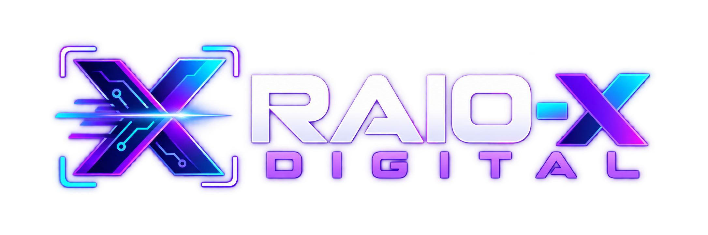

<p align="center">
  
</p>

# Raio-X Digital

> Scanner de sites desenvolvido por **David Xavier** e **Ingrid Lira** para transformar dados técnicos em oportunidades reais de melhoria e novos negócios.

[](https://nextjs.org/)
[](https://www.typescriptlang.org/)
[](https://vercel.com/)
[](#status-do-projeto)

## Sobre o projeto

O **Raio-X Digital** analisa uma URL pública e gera um diagnóstico prático sobre SEO, performance, responsividade, acessibilidade e estrutura técnica. A proposta é ajudar empresas a identificarem problemas que prejudicam sua presença digital e conectá-las às soluções certas de backend, frontend ou desenvolvimento completo.

O projeto também funciona como vitrine profissional da parceria entre:

- **[David Xavier](https://github.com/davidxavierxdplanschat)** — idealização, arquitetura, backend, APIs, segurança e integrações.
- **Ingrid Lira** — frontend, experiência visual, responsividade e apresentação dos resultados.

## O que o scanner analisa

- Validação e normalização segura de URLs públicas.
- Proteção contra localhost, redes privadas e respostas excessivamente grandes.
- Título, meta description, headings e URL canônica.
- `robots.txt`, sitemap, Open Graph e dados estruturados JSON-LD.
- Viewport, media queries, textos alternativos e experiência mobile.
- HTTPS, headers de segurança, cache, compressão e tempo de resposta.
- Métricas mobile do Google PageSpeed Insights/Lighthouse, quando disponíveis.
- Recomendações separadas entre backend, frontend e melhorias gerais.
- Relatório compartilhável e pronto para impressão.

## Tecnologias

- Next.js 16 com App Router
- React 19
- TypeScript
- Tailwind CSS
- Google PageSpeed Insights API
- Lucide Icons
- Vercel

## Como executar

Requisitos: Node.js 22 ou superior.

```bash
git clone https://github.com/davidxavierxdplanschat/raioxdigital.git
cd raioxdigital
npm install
npm run dev
```

Acesse o endereço indicado pelo terminal.

## API do scanner

O endpoint principal recebe uma URL pública:

```http
POST /api/scan
Content-Type: application/json

{
  "url": "https://exemplo.com"
}
```

Exemplo com JavaScript:

```js
const response = await fetch("/api/scan", {
  method: "POST",
  headers: { "Content-Type": "application/json" },
  body: JSON.stringify({ url: "https://exemplo.com" }),
});

const report = await response.json();
```

## Qualidade e build

Antes de enviar uma alteração:

```bash
npm run lint
npm run build
```

O build utiliza Next.js nativo e gera a saída padrão `.next` esperada pela Vercel.

## Deploy

O deploy oficial é realizado automaticamente pela integração **GitHub → Vercel** sempre que uma alteração validada chega à branch `main`.

Configuração esperada na Vercel:

- Framework Preset: `Next.js`
- Build Command: `npm run build`
- Output Directory: padrão do Next.js (`.next`)
- Install Command: `npm install`
- Node.js: `22.x`
- Root Directory: raiz do repositório

Opcionalmente, configure `GOOGLE_PAGESPEED_API_KEY` nas variáveis de ambiente da Vercel para ampliar a disponibilidade das métricas externas. A auditoria própria funciona sem credenciais.

## Status do projeto

O Raio-X Digital está em desenvolvimento ativo. Os próximos passos incluem histórico de análises, relatórios em PDF, painel de clientes e novas ferramentas gratuitas voltadas a SEO e presença digital.

## Autoria e créditos

### David Xavier

Criador e responsável principal pelo projeto, com atuação em **backend, arquitetura, APIs, integrações, segurança e estratégia técnica**.

- GitHub: **[@davidxavierxdplanschat](https://github.com/davidxavierxdplanschat)**
- Projeto: **[Raio-X Digital](https://github.com/davidxavierxdplanschat/raioxdigital)**

### Ingrid Lira

Parceira de desenvolvimento responsável pela frente de **frontend, interface, responsividade e experiência do usuário**.

### Apoio de IA

Desenvolvido com apoio da **GPT-5.6 SOL**, aliada de IA no planejamento, revisão técnica, documentação e evolução do projeto. As decisões, a autoria e a direção do produto permanecem com **David Xavier e Ingrid Lira**.

---

Feito com código, estratégia e parceria por **David Xavier & Ingrid Lira**.
